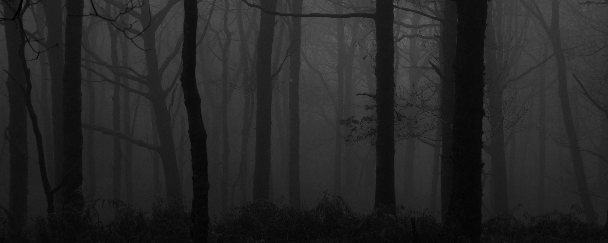

  

<h1>
  Hi There!
  
</h1>

I'm Maksim, a software engineering enthusiast from Germany.

I'm currently working on personal projects, exploring new technologies and improving my coding skills.

---

**Tools**

<table>
  <tr>
    <td><strong>Language</strong></td>
    <td></td>
  </tr>
  <tr>
    <td><strong>IDE</strong></td>
    <td></td>
  </tr>
  <tr>
    <td><strong>Design</strong></td>
    <td></td>
  </tr>
</table>

---

**About me**

- ☕ I love drinking tea
- 📺 Favorite TV Show: Dexter
- 🎱 I love ASCII fonts
